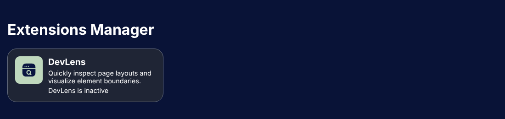
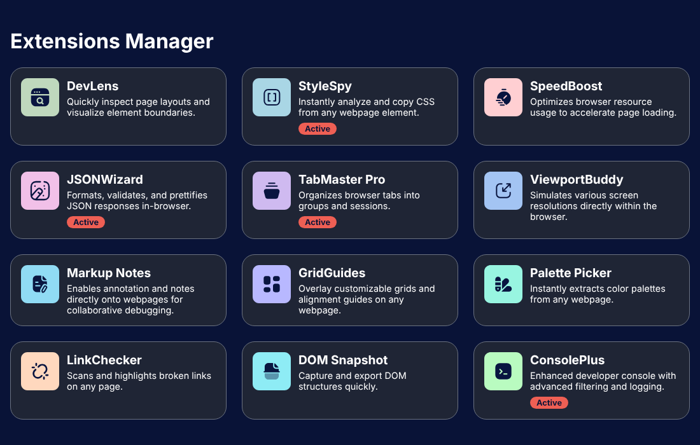

# 🧩 Extensions App — Version 1 Instructions

## 👋 Welcome!

In Version 1 you will start the Extensions Manager. You will get the extension data onto the page, first as one card, then as all of them.

## 🎯 Requirements

You will build a React app that:

- Shows extension data from `data.js`
- Is styled with CSS Flexbox
- Is deployed to a Netlify URL

**User stories:**

- As a user, I can see a card with an extension's logo, name and description
- As a user, I can see whether that extension is active or inactive
- As a user, I can see a card for every extension, not just one

## 💎 Demo

The finished app: https://jazzy-gingersnap-f22954.netlify.app/

## 🔗 Resources

- **Finished app:** https://jazzy-gingersnap-f22954.netlify.app/
- **Starter code:** [`extensions-app`](https://github.com/ac-frontend/extensions-app)
- **Pseudo-code worksheet:** `pseudo-code.txt` in this folder
- **Handy guides:** The teaching team at AnnieCannons has provided some [handy guides](https://docs.google.com/document/d/18jxCUA0bebCyYaIHy8aaKMgOQH4w5-b-iCGDWpV4K4M/edit?tab=t.0#heading=h.ykdbmvmlp0ag) to help you use GitHub and other coding tools

## 📝 Tips for building your project

See the tips and the commit message guide in the [main README](../README.md).

---

# 🚀 Roadmap

## Checkpoint 1: One Extension Card

### 💎 What it should look like

Your colors, spacing and fonts can be different. Make it your own.

### ⚙️ Fork and clone the starter repo

1. Fork the [`extensions-app`](https://github.com/ac-frontend/extensions-app) repo. Use this [fork and clone guide](https://docs.google.com/document/d/18jxCUA0bebCyYaIHy8aaKMgOQH4w5-b-iCGDWpV4K4M/edit?tab=t.55gk3qetux2a#heading=h.wbbot8ebr58a).
2. Clone **your fork** into your `dev` folder.
3. Open your `extensions-app` folder in VS Code.

### ⚙️ Review your starter files

Before you write code, look through what is already there. Pay attention to `src/data.js`, `public/assets`, and `package.json`.

### ⚙️ Run your code for the first time

1. In the terminal, make sure you are in the `extensions-app` folder.
2. Run `npm install`, then `npm run dev`.
3. Open the `localhost` link in your browser.

### ⚙️ Pseudo-code

Fill out the `pseudo-code.txt` file in this folder.

### ⚙️ Build the card

- [ ] Show the **first** extension in the array as a card
- [ ] The logo, name and description come from the data
- [ ] A line of text, built with a **template literal**, says whether the extension is active or inactive
- [ ] Comments in your code

### ⚙️ Commit, push and deploy

1. Commit your work with a meaningful message and push it to GitHub.
2. Deploy your project to Netlify.

---

## Checkpoint 2: Render All Extensions

### 💎 What it should look like

The cards sit in a Flexbox container and wrap onto new rows. Your layout can be different.

- [ ] Every extension in `data.js` shows as a card
- [ ] The cards are made with a loop, not copied and pasted
- [ ] The cards sit in a Flexbox container and wrap onto new rows
- [ ] Comments in your code
- [ ] You committed with meaningful messages, pushed, and deployed

**Bonus:** show a small "Active" badge only on active extensions.

