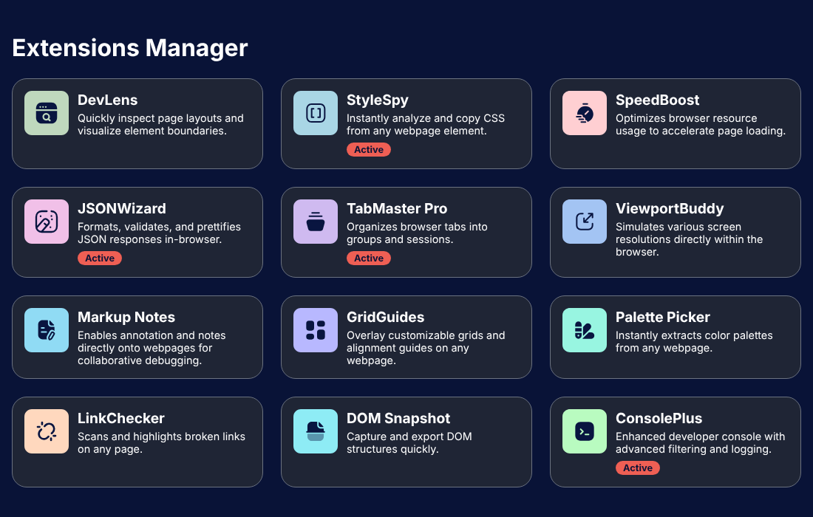
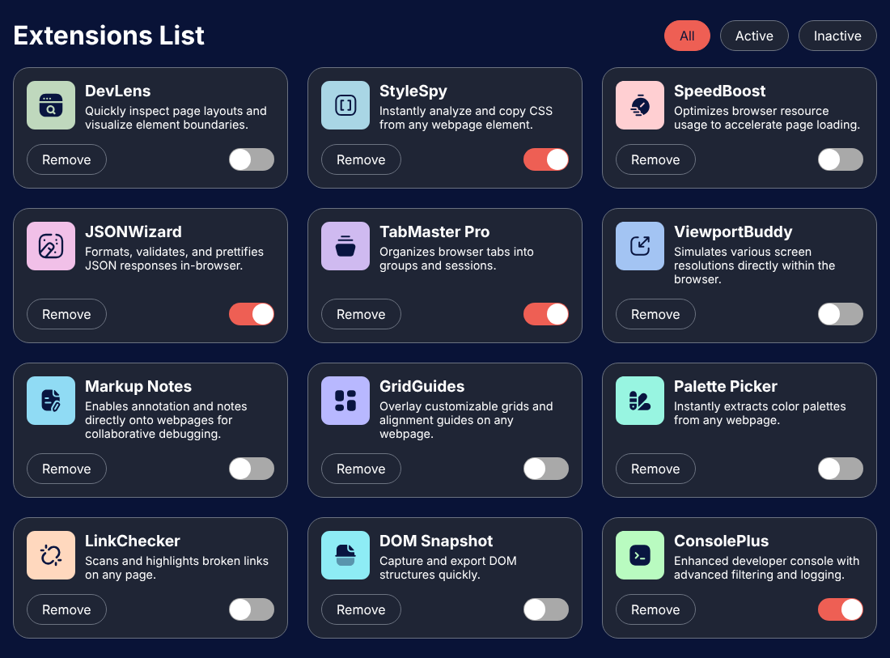

# 🧩 Extensions App — Version 2 Instructions

## 👋 Welcome!

In Version 2 you will rebuild the app from components, then make it interactive with state.

## 🎯 Requirements

You will build a React app that:

- Is built from components, in a `components` folder
- Passes data between components with props
- Keeps the extensions in state
- Is deployed to a Netlify URL

**User stories:**

- As a user, I see the same page as in Version 1
- As a user, I can turn an extension on or off with a toggle
- As a user, I can remove an extension
- As a user, I can show all, only active, or only inactive extensions

## 💎 Demo

The finished app: https://jazzy-gingersnap-f22954.netlify.app/

## 🔗 Resources

- **Finished app:** https://jazzy-gingersnap-f22954.netlify.app/
- **Starter code:** [`extensions-app`](https://github.com/ac-frontend/extensions-app)
- **Pseudo-code worksheet:** `pseudo-code.txt` in this folder
- **Documentation guides:** *(add link to the documentation guides)*
- **Toggle package (optional):** [react-switch](https://www.npmjs.com/package/react-switch)

## 📝 Tips for building your project

See the tips and the commit message guide in the [main README](../README.md).

## Checkpoint 1: Split Into Components

### 💎 What it should look like

The page should look the same as in Version 1. Only the code changes.

### ⚙️ Pseudo-code

Fill out Part 1 of the `pseudo-code.txt` file in this folder.

### ⚙️ Build

- [ ] At least **three components**, each in the `src/components` folder
- [ ] The data lives in one place and reaches the components through **props**
- [ ] No extension data is typed inside a component
- [ ] The page looks the same as before
- [ ] Comments in your code
- [ ] You committed with meaningful messages, pushed, and deployed

**Bonus:** use `.filter` to show only the active extensions.

---

## Checkpoint 2: Toggle, Remove and Filter

### 💎 What it should look like

Each card has a toggle and a Remove button. The selected filter button looks different from the others.

### ⚙️ Pseudo-code

Fill out Part 2 of the `pseudo-code.txt` file.

### ⚙️ Build

- [ ] The extensions are kept in **state**, starting from `data.js`
- [ ] Every card has a `Toggle` that turns that extension on or off
- [ ] Every card has a Remove button that removes that card
- [ ] Three `Button` components filter the list: All, Active and Inactive
- [ ] The selected filter button looks different
- [ ] Comments in your code
- [ ] You committed with meaningful messages, pushed, and deployed

You may use the `react-switch` package for the toggle. Its docs show an older version of React, so use them only to see which props are available.

---

# 🚀 Roadmap

## 🧱 Components

At the very least:

- **`Card`**: one extension
- **`Button`**: used for Remove and for the filter buttons
- **`Toggle`**: the on/off switch

